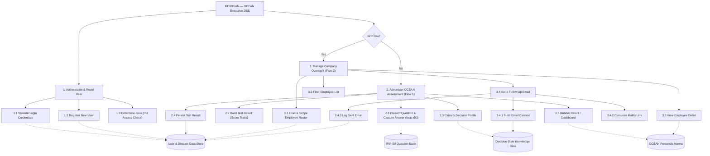
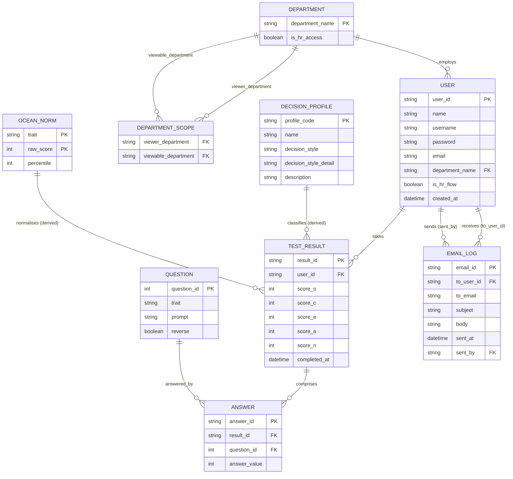

# Meridian — OCEAN Executive Decision-Support System (DSS)

**Business domain:** Banking Technology Company — This system called "Decision Style Assessment Tool for Banking Tech Leaders", Designed for helping the fintech and banking technology industry. It focuses on Engineering Managers, Chief Technology Officers (CTOs), and CEOs. These roles are responsible for decisions involving areas such as incident response, sprint prioritization, platform architecture, digital banking systems, and company-wide strategy.

**Purpose:** The purpose of the system is to understand how engineering leaders and managers make decisions by assessing their OCEAN (Big Five) personality profile, shown as a five-axis pentagon, and mapping the result to a decision profile.

The system helps identify whether a leader's natural decision-making style matches the requirements of their role. If a mismatch is found, the organization can use the results to support better role placement, leadership development, and improved decision-making effectiveness.

Stack: **Next.js 14 (App Router) + TypeScript + Tailwind CSS + PostgreSQL 16 (Docker)**, fully
responsive. Pages talk to Next.js API routes (`app/api/*`), which read and write Postgres.

---

## 1. Application flows

**Flow 1 — Individual assessment (normal employees)**
```
Register → Login → Take OCEAN Assessment → Get Result → Get suggestion
```

**Flow 2 — HR / management oversight**
```
Register -> Login → Check employee OCEAN status (Graph / Dashboard) → Suggest employee (sent via email)
```

**Routing rule at Login** (also enforced at Register):
- Department = *Human Resources, Engineering Manager, Chief Technology Officer,
  Chief Executive Officer* → **Flow 2**
- Any other department → **Flow 1**

**Flow 2 department visibility** — the Company OCEAN Overview scopes each role to the
business departments it's allowed to review:
- *Human Resources* and *Chief Executive Officer* → all departments
- *Chief Technology Officer* → IT Support only
- *Engineering Manager* → Retail Banking, Corporate Banking, Customer Service,
  Finance & Accounting

---

## 2. DSS architecture (Data / Model / Knowledge / Interface)

```
...
```

---

## 3. Structure chart

Top-down module decomposition (Yourdon/Constantine notation). `1.`–`3.` are the three
control modules invoked from `Login`/`Register`; the routing rule decides which of
`2` (Flow 1) or `3` (Flow 2) runs. The four modules at the bottom are shared/library
modules with high fan-in — called from several branches above, which is exactly why
they were factored out (`lib/store.ts`, `lib/questions.ts`, `lib/ocean.ts`,
`lib/oceanNorms.ts`).

| # | Module | Responsibility |
|---|---|---|
| 1 | Authenticate & Route User | Validate login, register new accounts, decide Flow 1 vs Flow 2 (`hasHrAccess`) |
| 2 | Administer OCEAN Assessment (Flow 1) | Run the question loop, score answers, convert them to percentiles, classify the decision profile, persist and render the result |
| 3 | Manage Company Oversight (Flow 2) | Load/scope the employee roster, filter it, show employee detail, send follow-up email |



> The dotted edges are calls into shared modules, not part of the primary control
> hierarchy — drawn separately so the fan-in (multiple unrelated branches calling
> the same data/knowledge module) is easy to spot. A fuller rendering with the
> classic data-couple / control-couple / loop annotations is in the project's
> Structure Chart artifact.

---

## 4. Use case diagram

```
...
```

---

## 5. ER diagram (database design)

The app stores this shape in PostgreSQL (`db/init/01_schema.sql`): `departments`, `users`,
`test_results`, `email_log`, plus `dashboards` and `sessions`.

### 5.1 Data required by the system

| Entity | Purpose | Key attributes |
|---|---|---|
| **DEPARTMENT** | Reference list of the 9 org units and which flow they route to | `department_name` (PK), `is_hr_access` |
| **DEPARTMENT_SCOPE** | Which business departments a Flow 2 role is allowed to view in the Company Overview | `viewer_department` (FK), `viewable_department` (FK) |
| **USER** | Every account — Flow 1 employees and Flow 2 HR/executives | `user_id` (PK), `name`, `username`, `password`, `email`, `department_name` (FK), `is_hr_flow`, `created_at` |
| **QUESTION** | The fixed IPIP-50 question bank | `question_id` (PK), `trait`, `prompt`, `reverse` |
| **TEST_RESULT** | One completed assessment attempt for a user | `result_id` (PK), `user_id` (FK), `score_o`, `score_c`, `score_e`, `score_a`, `score_n`, `completed_at` |
| **ANSWER** | Each individual answer inside one attempt (scoring audit trail) | `answer_id` (PK), `result_id` (FK), `question_id` (FK), `answer_value` |
| **OCEAN_NORM** | Percentile of each raw trait score | `trait` (PK), `raw_score` (PK), `percentile` |
| **DECISION_PROFILE** | Knowledge base: strongest trait → decision profile | `profile_code` (PK), `name`, `decision_style`, `decision_style_detail`, `description` |
| **EMAIL_LOG** | Outbound follow-up/reminder emails sent by HR/executives | `email_id` (PK), `to_user_id` (FK), `to_email`, `subject`, `body`, `sent_at`, `sent_by` (FK) |

### 5.2 Diagram



> Note on the prototype vs. this diagram: the Postgres database persists `DEPARTMENT`, `USER`,
> `TEST_RESULT`, `EMAIL_LOG`, saved dashboards and login sessions — `QUESTION`,
> `ANSWER`, `DECISION_PROFILE`, `OCEAN_NORM`, and `DEPARTMENT_SCOPE` are static/derived in code
> (`lib/questions.ts`, `lib/ocean.ts`, `lib/oceanNorms.ts`, `lib/types.ts`). They are included
> here because they are still data the *system* depends on, and a production build would
> move them into real tables (and start persisting individual `ANSWER` rows, which the
> prototype currently discards once scored).

---

## 6. Model: OCEAN scoring

The assessment is the public-domain IPIP-50: 50 statements, 10 per trait, each rated
1 (Disagree) to 5 (Agree). See `lib/questions.ts`.

1. Reverse-keyed items score as `6 - answer`.
2. Each trait's items are summed into a raw score of 10–50.
3. The raw score becomes a percentile against 592,204 IPIP-50 respondents
   (`lib/oceanNorms.ts`). These percentiles are the five axes of the pentagon.

Keeping the instrument identical to the source dataset is what makes those percentiles
valid, so the items are deliberately not reworded into banking scenarios.

The employee dataset behind this model is documented in [`data/README.md`](data/README.md).
Its OCEAN columns are a synthetic link between separate sources, not measurements of
those employees.

---

## 7. Knowledge base: IF-THEN rules

| Rule | IF | THEN |
|---|---|---|
| R1 | Leadership index ≥ 70 | Flag as executive-track |
| R2 | Strongest trait ≥ 60th percentile | Decision profile = that trait's profile |
| R3 | No trait reaches the 60th percentile | Decision profile = The Balanced Generalist |

The **leadership index** is the mean of the five percentiles, with Neuroticism inverted,
weighted by each trait's correlation with leadership in Judge et al. (2002):
E .31, C .28, N −.24, O .24, A .08.

For R2, Neuroticism counts through its inverse, emotional stability. Ties resolve in
that same weight order.

| Strongest trait | Decision profile | Decision style |
|---|---|---|
| Extraversion | The Mobiliser | Decisive people-led driver |
| Conscientiousness | The Steward | Disciplined process-first executor |
| Emotional stability (low N) | The Steady Hand | Composed under-pressure decider |
| Openness | The Visionary | Long-horizon systems thinker |
| Agreeableness | The Consensus Builder | Trust-building collaborative decider |
| None | The Balanced Generalist | Adaptable situational decider |

HR Executives can filter the company view to **executive-fit profiles only** when
shortlisting candidates for upper-management roles.

---

## 8. UI / dashboard design notes

The interface uses a deep-navy / brass banking palette (`Fraunces` display serif +
`Inter` body sans) to read as a trustworthy internal executive tool rather than a
generic SaaS template. Screens included in this prototype (design these further in
Figma if a high-fidelity mock is required for submission):

- **Login** — username, password, department selector, routing hint
- **Register** — Flow 1 entry point
- **Assessment** — one statement at a time, progress bar, 5-point scale
- **Result** — OCEAN pentagon, trait table, decision profile card
- **Dashboard** (employee) — decision profile, OCEAN pentagon, retake option
- **Company Overview** (HR/managers) — stats, filters, staff table, email log, HR Assistant chatbot

### 8.1 HR Assistant (decision support chatbot)

The round chatbot logo at the bottom right of the Company Overview opens the HR Assistant
(UI in `components/HrChatbot.tsx`). It has two layers:

1. **Rule engine** (`lib/chatbot.ts`): each question is matched to an intent, and the answer
   comes from the KPI alert rules and IF-THEN rules in `lib/ocean.ts`, so every figure can be
   traced to a rule.
2. **Free LLM** (`app/api/chat`, `lib/server/llm.ts`, `lib/server/chatPrompt.ts`): the server
   loads the employees in the viewer's scope from Postgres, runs the rule engine, and gives the
   model only that data (rule answer, KPI overview, employee table, workforce stats, rule
   definitions). The model writes a natural-language answer, in Thai or English, which streams
   into the chat. The rule engine's tables and alerts stay available under
   **Data from the rule engine**.

The default model is **Qwen 2.5 3B** on **Ollama**, started by `docker compose up -d` (the
`ollama-pull` service downloads it, ~1.9 GB, on first run). It is free, needs no API key, and no
employee data leaves the machine. If the model is unreachable the chatbot falls back to the rule
engine on its own; the header shows which mode is active.

Docker on macOS can't use the Apple GPU, so the model runs on CPU: the first question takes about
a minute and later ones are faster because the prompt is cached. To speed it up, either install
Ollama natively (`brew install ollama && ollama serve`, then `ollama pull qwen2.5:3b`; set
`LLM_BASE_URL=http://localhost:11434/v1` and stop the Docker `ollama` service), or point
`LLM_BASE_URL`/`LLM_MODEL`/`LLM_API_KEY` in `.env.local` at a free cloud API (Groq, Gemini,
OpenRouter; see `.env.example`). With a cloud API, employee data is sent to that provider.
It only sees the departments in the signed-in role's scope.

| Intent | Example question | Rules used |
|---|---|---|
| KPI status | Show the KPI overview | Rule set 10 (KPI 2–7 Red/Yellow/Green), rule set 11 situation |
| Recommendation | What should we do first? | Rule set 12 (REC-2 to REC-15), rule 12-16 ranking, rule set 9 talent actions |
| Scenario (input to advice) | Low performance band is 52% and stars are 9% · E 80, C 55, O 60, A 40, N 30 · Leadership index 74 and the employee is a Star | Rule sets 4, 5, 9, 10 and 12 |
| Department | Stats for IT Support · Compare departments | KPI 2–6 per department |
| Profiles | Profile distribution in Retail Banking | KPI 2 |
| Employee | Tell me about Aran | Profile, Leadership Index, L1/L2 |
| Shortlist | Who should be on the succession shortlist? | Rules 5-1, 9-1 (REC-3), 9-3 (REC-5) |
| 9-Box | How many Enigmas are there? · Show the 9-box grid | 9-Box cells and actions, KPI 6 |
| Pending | Who hasn't completed the assessment? | KPI 7 |
| Explain | How is the Leadership Index calculated? · What is KPI 4? | Knowledge base |

Answers label their source. **App** figures use the employees registered in this
prototype (KPI 2 and 3 wait for 5 results). **Workforce** figures use the 17,414
employees of `data/employees_ocean_hr.csv`, summarised per department in
`lib/workforceStats.ts`. Regenerate that file after rebuilding the CSV:

```bash
python data/build_workforce_stats.py --repo .
```

---

## 9. Getting started
Requires Node.js and Docker Desktop.

```bash
npm install
cp .env.example .env.local   # DATABASE_URL for the Docker database
npm run db:up                # start Postgres (5433), Adminer (8082) and Ollama LLM (11434)
npm run db:check             # verify the connection, tables and seed data
npm run dev
```
Then open http://localhost:3000.

After the splash screen the app asks for an **access code** before the login page. Set it as `ACCESS_CODE` in `.env.local` (and in your hosting provider's environment variables when deployed); ask the team for the value — it is intentionally not stored in the repo.

The schema and demo data in `db/init/` load automatically the first time the database starts.

### Deploying to Vercel
1. **Database** — Vercel can't run the Docker Postgres. Create a free hosted Postgres
   (Vercel → Storage → **Neon**, or [neon.tech](https://neon.tech) / [Supabase](https://supabase.com))
   and copy its connection string (it ends in `?sslmode=require`).
2. **Load the schema and demo data once** from your machine:
   ```bash
   DATABASE_URL="postgres://…?sslmode=require" npm run db:setup
   DATABASE_URL="postgres://…?sslmode=require" npm run db:check
   ```
3. **Import the repo in Vercel** (framework: Next.js, no build settings to change) and add these
   in Project Settings → Environment Variables:

   | Name | Value | Required |
   |---|---|---|
   | `DATABASE_URL` | the hosted Postgres URL (not needed if the Neon integration added `POSTGRES_URL`) | yes |
   | `ACCESS_CODE` | the access code (ask the team; not stored in the repo) | yes — without it nobody gets past `/access` |
   | `LLM_BASE_URL`, `LLM_MODEL`, `LLM_API_KEY` | a cloud LLM, e.g. Groq (see `.env.example`) | no — without them the chatbot uses rule-based answers |
   | `ALLOW_DEMO_RESET` | `true` to keep the "Reset demo data" button working | no |

4. **Redeploy** after changing any variable — Vercel only reads them at deploy time.
   Then check `https://<your-app>.vercel.app/api/health`.

### 9.1 Checking the database
| How | What it shows |
|---|---|
| `npm run db:check` | Connection, row count per table, integrity checks (orphan results, duplicate usernames, unhashed passwords, HR accounts with results), and a table of every user |
| http://localhost:3000/api/health | JSON: is the DB reachable, latency, row counts |
| http://localhost:8082 (Adminer) | Browse and query tables in the browser. System **PostgreSQL**, Server **db**, User / Password / Database **meridian** |
| `npm run db:psql` | A `psql` shell inside the container |

Other scripts: `npm run db:down` (stop), `npm run db:reset` (stop, **delete all data**, start fresh from the seed).
The **Reset demo data** link on the login page also re-seeds the database (disabled in production).

---

## 10. Demo accounts 
(seeded from `db/init/02_seed.sql`):
| Username | Password | Department | Flow |
|---|---|---|---|
| aran.suksawat | password123 | Retail Banking | Flow 1 (has a result) |
| warut.phetchara | password123 | Retail Banking | Flow 1 (no result yet) |
| hr.suda | hrpass123 | Human Resources | Flow 2 (all departments) |
| ceo.malee | hrpass123 | Chief Executive Officer | Flow 2 (all departments) |
| cto.peter | hrpass123 | Chief Technology Officer | Flow 2 (IT Support only) |
| em.nan | hrpass123 | Engineering Manager | Flow 2 (Retail/Corporate Banking, Customer Service, Finance & Accounting) |

Passwords are stored as bcrypt hashes (`pgcrypto`). Uploaded dashboard *files* still live in the
browser's IndexedDB; only their metadata is in Postgres.
