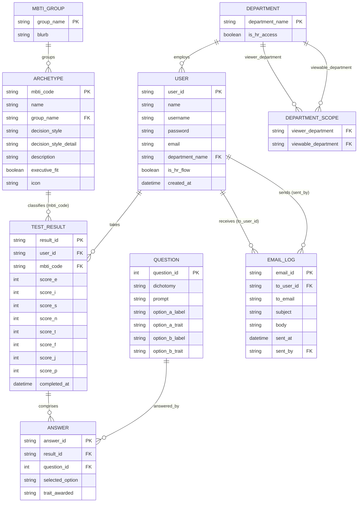

# Meridian — MBTI Executive Decision-Support System (DSS)

**Business domain:** Banking Technology Company — This system called "Decision Style Assessment Tool for Banking Tech Leaders", Designed for helping the fintech and banking technology industry. It focuses on Engineering Managers, Chief Technology Officers (CTOs), and CEOs. These roles are responsible for decisions involving areas such as incident response, sprint prioritization, platform architecture, digital banking systems, and company-wide strategy.

**Purpose:** The purpose of the system is to understand how engineering leaders and managers make decisions by assessing their MBTI personality type and mapping the result to one of four Executive Decision Maker Styles.

The system helps identify whether a leader's natural decision-making style matches the requirements of their role. If a mismatch is found, the organization can use the results to support better role placement, leadership development, and improved decision-making effectiveness.

Stack: **Next.js 14 (App Router) + TypeScript + Tailwind CSS**, fully responsive, mock
localStorage-backed data layer (no external DB/API needed to run the prototype).

---

## 1. Application flows

**Flow 1 — Individual assessment (normal employees)**
```
Register → Login → Take MBTI Test → Get Result → Get suggestion
```

**Flow 2 — HR / management oversight**
```
Register -> Login → Check employee MBTI status (Graph / Dashboard) → Suggest employee (sent via email)
```

**Routing rule at Login** (also enforced at Register):
- Department = *Human Resources, Engineering Manager, Chief Technology Officer,
  Chief Executive Officer* → **Flow 2**
- Any other department → **Flow 1**

**Flow 2 department visibility** — the Company MBTI Overview scopes each role to the
business departments it's allowed to review:
- *Human Resources* and *Chief Executive Officer* → all departments
- *Chief Technology Officer* → IT Support only
- *Engineering Manager* → Retail Banking, Corporate Banking, Customer Service,
  Finance & Accounting

---

## 2. DSS architecture (Data / Model / Knowledge / Interface)

```
...
```

---

## 3. Structure chart

Top-down module decomposition (Yourdon/Constantine notation). `1.`–`3.` are the three
control modules invoked from `Login`/`Register`; the routing rule decides which of
`2` (Flow 1) or `3` (Flow 2) runs. The four modules at the bottom are shared/library
modules with high fan-in — called from several branches above, which is exactly why
they were factored out (`lib/store.ts`, `lib/questions.ts`, `lib/mbti.ts`,
`lib/groups.ts`).

| # | Module | Responsibility |
|---|---|---|
| 1 | Authenticate & Route User | Validate login, register new accounts, decide Flow 1 vs Flow 2 (`hasHrAccess`) |
| 2 | Administer MBTI Assessment (Flow 1) | Run the question loop, score answers, resolve the MBTI type, classify the archetype, persist and render the result |
| 3 | Manage Company Oversight (Flow 2) | Load/scope the employee roster, filter it, show employee detail, send follow-up email |


> The dotted edges are calls into shared modules, not part of the primary control
> hierarchy — drawn separately so the fan-in (multiple unrelated branches calling
> the same data/knowledge module) is easy to spot. A fuller rendering with the
> classic data-couple / control-couple / loop annotations is in the project's
> Structure Chart artifact.

---

## 4. Use case diagram

```
...
```

---

## 5. ER diagram (database design)

The prototype stores this shape in `localStorage`; the same schema maps directly onto
relational tables for a production build.

### 5.1 Data required by the system

| Entity | Purpose | Key attributes |
|---|---|---|
| **DEPARTMENT** | Reference list of the 9 org units and which flow they route to | `department_name` (PK), `is_hr_access` |
| **DEPARTMENT_SCOPE** | Which business departments a Flow 2 role is allowed to view in the Company Overview | `viewer_department` (FK), `viewable_department` (FK) |
| **USER** | Every account — Flow 1 employees and Flow 2 HR/executives | `user_id` (PK), `name`, `username`, `password`, `email`, `department_name` (FK), `is_hr_flow`, `created_at` |
| **QUESTION** | The fixed MBTI question bank (32 items) | `question_id` (PK), `dichotomy`, `prompt`, `option_a_label`, `option_a_trait`, `option_b_label`, `option_b_trait` |
| **TEST_RESULT** | One completed assessment attempt for a user | `result_id` (PK), `user_id` (FK), `mbti_code` (FK), `score_e..score_p`, `completed_at` |
| **ANSWER** | Each individual answer inside one attempt (Layer‑1 scoring audit trail) | `answer_id` (PK), `result_id` (FK), `question_id` (FK), `selected_option`, `trait_awarded` |
| **MBTI_GROUP** | The 4 temperament groups | `group_name` (PK), `blurb` |
| **ARCHETYPE** | Knowledge base: MBTI code → decision-maker archetype | `mbti_code` (PK), `name`, `group_name` (FK), `decision_style`, `decision_style_detail`, `description`, `executive_fit`, `icon` |
| **EMAIL_LOG** | Outbound follow-up/reminder emails sent by HR/executives | `email_id` (PK), `to_user_id` (FK), `to_email`, `subject`, `body`, `sent_at`, `sent_by` (FK) |

### 5.2 Diagram



> Note on the prototype vs. this diagram: the current `localStorage` layer (`lib/store.ts`)
> only persists `USER` (with its `TestResult` embedded) and `EMAIL_LOG` — `QUESTION`,
> `ANSWER`, `ARCHETYPE`, `MBTI_GROUP`, and `DEPARTMENT_SCOPE` are static/derived in code
> (`lib/questions.ts`, `lib/mbti.ts`, `lib/groups.ts`, `lib/types.ts`). They are included
> here because they are still data the *system* depends on, and a production build would
> move them into real tables (and start persisting individual `ANSWER` rows, which the
> prototype currently discards once scored).

---

## 6. Model: question classification tree

Each test item targets exactly one of four dichotomies; every dichotomy resolves to one
letter of the 4-letter MBTI code, which the knowledge base then maps to a decision-maker
archetype.

```
...
```

> The real question bank is intentionally **not included** in this prototype
> (per project scope) — see `lib/questions.ts`, which documents the exact shape
> to drop your own question set into.

---

## 7. Knowledge base: IF-THEN rules (excerpt)
# MBTI Rule-Based Scoring System

## 1. Extrovert (E) or Introvert (I)

| Rule | IF: Q_ID | IF: Answer | THEN: Trait | THEN: Score |
| ---- | -------- | ---------- | ----------- | ----------- |
| R1   | EI_Q1    | a          | E           | +1          |
| R2   | EI_Q1    | b          | I           | +1          |
| R3   | EI_Q2    | a          | E           | +1          |
| R4   | EI_Q2    | b          | I           | +1          |
| R5   | EI_Q3    | a          | E           | +1          |
| R6   | EI_Q3    | b          | I           | +1          |
| R7   | EI_Q4    | a          | E           | +1          |
| R8   | EI_Q4    | b          | I           | +1          |
| R9   | EI_Q5    | a          | E           | +1          |
| R10  | EI_Q5    | b          | I           | +1          |
| R11  | EI_Q6    | a          | E           | +1          |
| R12  | EI_Q6    | b          | I           | +1          |
| R13  | EI_Q7    | a          | E           | +1          |
| R14  | EI_Q7    | b          | I           | +1          |
| R15  | EI_Q8    | a          | E           | +1          |
| R16  | EI_Q8    | b          | I           | +1          |

---

## 2. Sensing (S) or Intuition (N)

| Rule | IF: Q_ID | IF: Answer | THEN: Trait | THEN: Score |
| ---- | -------- | ---------- | ----------- | ----------- |
| R17  | SN_Q1    | a          | S           | +1          |
| R18  | SN_Q1    | b          | N           | +1          |
| R19  | SN_Q2    | a          | S           | +1          |
| R20  | SN_Q2    | b          | N           | +1          |
| R21  | SN_Q3    | a          | S           | +1          |
| R22  | SN_Q3    | b          | N           | +1          |
| R23  | SN_Q4    | a          | S           | +1          |
| R24  | SN_Q4    | b          | N           | +1          |
| R25  | SN_Q5    | a          | S           | +1          |
| R26  | SN_Q5    | b          | N           | +1          |
| R27  | SN_Q6    | a          | S           | +1          |
| R28  | SN_Q6    | b          | N           | +1          |
| R29  | SN_Q7    | a          | S           | +1          |
| R30  | SN_Q7    | b          | N           | +1          |

---

## 3. Thinking (T) or Feeling (F)

| Rule | IF: Q_ID | IF: Answer | THEN: Trait | THEN: Score |
| ---- | -------- | ---------- | ----------- | ----------- |
| R31  | TF_Q1    | a          | T           | +1          |
| R32  | TF_Q1    | b          | F           | +1          |
| R33  | TF_Q2    | a          | T           | +1          |
| R34  | TF_Q2    | b          | F           | +1          |
| R35  | TF_Q3    | a          | T           | +1          |
| R36  | TF_Q3    | b          | F           | +1          |
| R37  | TF_Q4    | a          | T           | +1          |
| R38  | TF_Q4    | b          | F           | +1          |
| R39  | TF_Q5    | a          | T           | +1          |
| R40  | TF_Q5    | b          | F           | +1          |
| R41  | TF_Q6    | a          | T           | +1          |
| R42  | TF_Q6    | b          | F           | +1          |
| R43  | TF_Q7    | a          | T           | +1          |
| R44  | TF_Q7    | b          | F           | +1          |
| R45  | TF_Q8    | a          | T           | +1          |
| R46  | TF_Q8    | b          | F           | +1          |

---

## 4. Judging (J) or Perceiving (P)

| Rule | IF: Q_ID | IF: Answer | THEN: Trait | THEN: Score |
| ---- | -------- | ---------- | ----------- | ----------- |
| R47  | JP_Q1    | a          | J           | +1          |
| R48  | JP_Q1    | b          | P           | +1          |
| R49  | JP_Q2    | a          | J           | +1          |
| R50  | JP_Q2    | b          | P           | +1          |
| R51  | JP_Q3    | a          | J           | +1          |
| R52  | JP_Q3    | b          | P           | +1          |
| R53  | JP_Q4    | a          | J           | +1          |
| R54  | JP_Q4    | b          | P           | +1          |
| R55  | JP_Q5    | a          | J           | +1          |
| R56  | JP_Q5    | b          | P           | +1          |
| R57  | JP_Q6    | a          | J           | +1          |
| R58  | JP_Q6    | b          | P           | +1          |
| R59  | JP_Q7    | a          | J           | +1          |
| R60  | JP_Q7    | b          | P           | +1          |

---

# Trait Resolution Rules — Layer 2

After calculating the scores from Layer 1, the dominant trait for each MBTI dimension is determined using the following rules.

| Rule | IF                | THEN            |
| ---- | ----------------- | --------------- |
| D1   | E_score > I_score | Dominant_EI = E |
| D1'  | E_score ≤ I_score | Dominant_EI = I |
| D2   | S_score > N_score | Dominant_SN = S |
| D2'  | S_score ≤ N_score | Dominant_SN = N |
| D3   | T_score > F_score | Dominant_TF = T |
| D3'  | T_score ≤ F_score | Dominant_TF = F |
| D4   | J_score > P_score | Dominant_JP = J |
| D4'  | J_score ≤ P_score | Dominant_JP = P |

HR Executives can filter the company view to **executive-fit archetypes only** when
shortlisting candidates for upper-management roles.

---

## 8. UI / dashboard design notes

The interface uses a deep-navy / brass banking palette (`Fraunces` display serif +
`Inter` body sans) to read as a trustworthy internal executive tool rather than a
generic SaaS template. Screens included in this prototype (design these further in
Figma if a high-fidelity mock is required for submission):

- **Login** — username, password, department selector, routing hint
- **Register** — Flow 1 entry point
- **MBTI Test** — one question at a time, progress bar, dichotomy label
- **Result** — 4-letter type, dichotomy bar charts, archetype card
- **Dashboard** (employee) — personal type, breakdown, retake option
- **Company Overview** (HR/managers) — stats, filters, staff table, email log

---

## 9. Getting started
1. Open terminal in your Machine
2. Run this command
```bash
npm install
npm run dev
```
3. Then open http://localhost:3000.

---

## 10. Demo accounts 
(seeded automatically on first load):
| Username | Password | Department | Flow |
|---|---|---|---|
| aran.suksawat | password123 | Retail Banking | Flow 1 (has a result) |
| warut.phetchara | password123 | Retail Banking | Flow 1 (no result yet) |
| hr.suda | hrpass123 | Human Resources | Flow 2 (all departments) |
| ceo.malee | hrpass123 | Chief Executive Officer | Flow 2 (all departments) |
| cto.peter | hrpass123 | Chief Technology Officer | Flow 2 (IT Support only) |
| em.nan | hrpass123 | Engineering Manager | Flow 2 (Retail/Corporate Banking, Customer Service, Finance & Accounting) |

All data is mock and stored in the browser's `localStorage` — no backend required.
