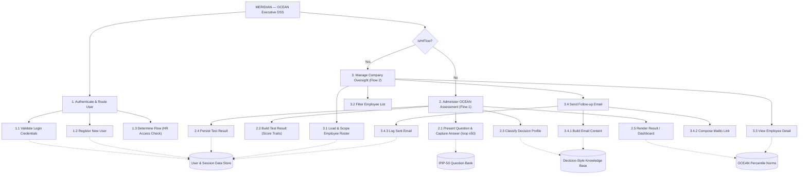
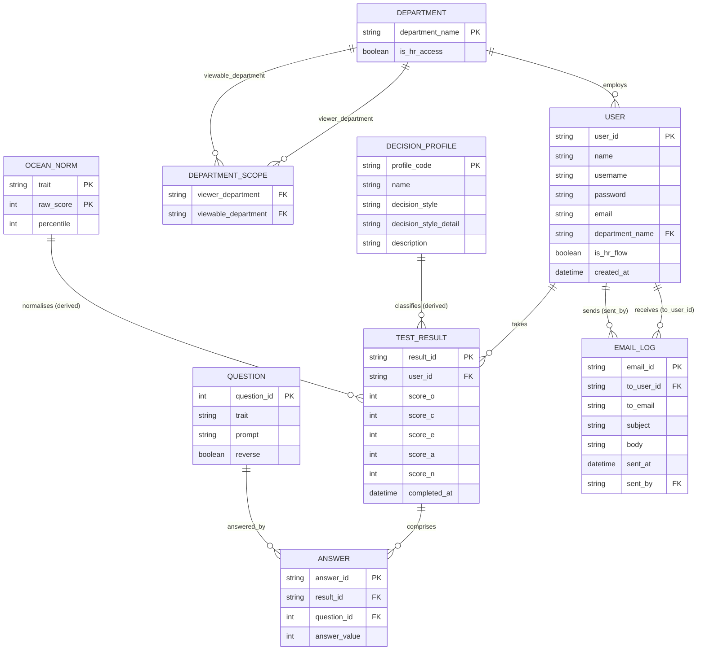

# Meridian — OCEAN Executive Decision-Support System (DSS)

**Business domain:** Banking Technology Company — This system called "Decision Style Assessment Tool for Banking Tech Leaders", Designed for helping the fintech and banking technology industry. It focuses on Engineering Managers, Chief Technology Officers (CTOs), and CEOs. These roles are responsible for decisions involving areas such as incident response, sprint prioritization, platform architecture, digital banking systems, and company-wide strategy.

**Purpose:** The purpose of the system is to understand how engineering leaders and managers make decisions by assessing their OCEAN (Big Five) personality profile, shown as a five-axis pentagon, and mapping the result to a decision profile.

The system helps identify whether a leader's natural decision-making style matches the requirements of their role. If a mismatch is found, the organization can use the results to support better role placement, leadership development, and improved decision-making effectiveness.

Stack: **Next.js 14 (App Router) + TypeScript + Tailwind CSS**, fully responsive, mock
localStorage-backed data layer (no external DB/API needed to run the prototype).

---

## 1. Application flows

**Flow 1 — Individual assessment (normal employees)**
```
Register → Login → Take OCEAN Assessment → Get Result → Get suggestion
```

**Flow 2 — HR / management oversight**
```
Register -> Login → Check employee OCEAN status (Graph / Dashboard) → Suggest employee (sent via email)
```

**Routing rule at Login** (also enforced at Register):
- Department = *Human Resources, Engineering Manager, Chief Technology Officer,
  Chief Executive Officer* → **Flow 2**
- Any other department → **Flow 1**

**Flow 2 department visibility** — the Company OCEAN Overview scopes each role to the
business departments it's allowed to review:
- *Human Resources* and *Chief Executive Officer* → all departments
- *Chief Technology Officer* → IT Support only
- *Engineering Manager* → Retail Banking, Corporate Banking, Customer Service,
  Finance & Accounting

---

## 2. DSS architecture (Data / Model / Knowledge / Interface)

```
...
```

---

## 3. Structure chart

Top-down module decomposition (Yourdon/Constantine notation). `1.`–`3.` are the three
control modules invoked from `Login`/`Register`; the routing rule decides which of
`2` (Flow 1) or `3` (Flow 2) runs. The four modules at the bottom are shared/library
modules with high fan-in — called from several branches above, which is exactly why
they were factored out (`lib/store.ts`, `lib/questions.ts`, `lib/ocean.ts`,
`lib/oceanNorms.ts`).

| # | Module | Responsibility |
|---|---|---|
| 1 | Authenticate & Route User | Validate login, register new accounts, decide Flow 1 vs Flow 2 (`hasHrAccess`) |
| 2 | Administer OCEAN Assessment (Flow 1) | Run the question loop, score answers, convert them to percentiles, classify the decision profile, persist and render the result |
| 3 | Manage Company Oversight (Flow 2) | Load/scope the employee roster, filter it, show employee detail, send follow-up email |



> The dotted edges are calls into shared modules, not part of the primary control
> hierarchy — drawn separately so the fan-in (multiple unrelated branches calling
> the same data/knowledge module) is easy to spot. A fuller rendering with the
> classic data-couple / control-couple / loop annotations is in the project's
> Structure Chart artifact.

---

## 4. Use case diagram

```
...
```

---

## 5. ER diagram (database design)

The prototype stores this shape in `localStorage`; the same schema maps directly onto
relational tables for a production build.

### 5.1 Data required by the system

| Entity | Purpose | Key attributes |
|---|---|---|
| **DEPARTMENT** | Reference list of the 9 org units and which flow they route to | `department_name` (PK), `is_hr_access` |
| **DEPARTMENT_SCOPE** | Which business departments a Flow 2 role is allowed to view in the Company Overview | `viewer_department` (FK), `viewable_department` (FK) |
| **USER** | Every account — Flow 1 employees and Flow 2 HR/executives | `user_id` (PK), `name`, `username`, `password`, `email`, `department_name` (FK), `is_hr_flow`, `created_at` |
| **QUESTION** | The fixed IPIP-50 question bank | `question_id` (PK), `trait`, `prompt`, `reverse` |
| **TEST_RESULT** | One completed assessment attempt for a user | `result_id` (PK), `user_id` (FK), `score_o`, `score_c`, `score_e`, `score_a`, `score_n`, `completed_at` |
| **ANSWER** | Each individual answer inside one attempt (scoring audit trail) | `answer_id` (PK), `result_id` (FK), `question_id` (FK), `answer_value` |
| **OCEAN_NORM** | Percentile of each raw trait score | `trait` (PK), `raw_score` (PK), `percentile` |
| **DECISION_PROFILE** | Knowledge base: strongest trait → decision profile | `profile_code` (PK), `name`, `decision_style`, `decision_style_detail`, `description` |
| **EMAIL_LOG** | Outbound follow-up/reminder emails sent by HR/executives | `email_id` (PK), `to_user_id` (FK), `to_email`, `subject`, `body`, `sent_at`, `sent_by` (FK) |

### 5.2 Diagram



> Note on the prototype vs. this diagram: the current `localStorage` layer (`lib/store.ts`)
> only persists `USER` (with its `TestResult` embedded) and `EMAIL_LOG` — `QUESTION`,
> `ANSWER`, `DECISION_PROFILE`, `OCEAN_NORM`, and `DEPARTMENT_SCOPE` are static/derived in code
> (`lib/questions.ts`, `lib/ocean.ts`, `lib/oceanNorms.ts`, `lib/types.ts`). They are included
> here because they are still data the *system* depends on, and a production build would
> move them into real tables (and start persisting individual `ANSWER` rows, which the
> prototype currently discards once scored).

---

## 6. Model: OCEAN scoring

The assessment is the public-domain IPIP-50: 50 statements, 10 per trait, each rated
1 (Disagree) to 5 (Agree). See `lib/questions.ts`.

1. Reverse-keyed items score as `6 - answer`.
2. Each trait's items are summed into a raw score of 10–50.
3. The raw score becomes a percentile against 592,204 IPIP-50 respondents
   (`lib/oceanNorms.ts`). These percentiles are the five axes of the pentagon.

Keeping the instrument identical to the source dataset is what makes those percentiles
valid, so the items are deliberately not reworded into banking scenarios.

The employee dataset behind this model is documented in [`data/README.md`](data/README.md).
Its OCEAN columns are a synthetic link between separate sources, not measurements of
those employees.

---

## 7. Knowledge base: IF-THEN rules

| Rule | IF | THEN |
|---|---|---|
| R1 | Leadership index ≥ 70 | Flag as executive-track |
| R2 | Strongest trait ≥ 60th percentile | Decision profile = that trait's profile |
| R3 | No trait reaches the 60th percentile | Decision profile = The Balanced Generalist |

The **leadership index** is the mean of the five percentiles, with Neuroticism inverted,
weighted by each trait's correlation with leadership in Judge et al. (2002):
E .31, C .28, N −.24, O .24, A .08.

For R2, Neuroticism counts through its inverse, emotional stability. Ties resolve in
that same weight order.

| Strongest trait | Decision profile | Decision style |
|---|---|---|
| Extraversion | The Mobiliser | Decisive people-led driver |
| Conscientiousness | The Steward | Disciplined process-first executor |
| Emotional stability (low N) | The Steady Hand | Composed under-pressure decider |
| Openness | The Visionary | Long-horizon systems thinker |
| Agreeableness | The Consensus Builder | Trust-building collaborative decider |
| None | The Balanced Generalist | Adaptable situational decider |

HR Executives can filter the company view to **executive-fit profiles only** when
shortlisting candidates for upper-management roles.

---

## 8. UI / dashboard design notes

The interface uses a deep-navy / brass banking palette (`Fraunces` display serif +
`Inter` body sans) to read as a trustworthy internal executive tool rather than a
generic SaaS template. Screens included in this prototype (design these further in
Figma if a high-fidelity mock is required for submission):

- **Login** — username, password, department selector, routing hint
- **Register** — Flow 1 entry point
- **Assessment** — one statement at a time, progress bar, 5-point scale
- **Result** — OCEAN pentagon, trait table, decision profile card
- **Dashboard** (employee) — decision profile, OCEAN pentagon, retake option
- **Company Overview** (HR/managers) — stats, filters, staff table, email log

---

## 9. Getting started
1. Open terminal in your Machine
2. Run this command
```bash
npm install
npm run dev
```
3. Then open http://localhost:3000.

---

## 10. Demo accounts 
(seeded automatically on first load):
| Username | Password | Department | Flow |
|---|---|---|---|
| aran.suksawat | password123 | Retail Banking | Flow 1 (has a result) |
| warut.phetchara | password123 | Retail Banking | Flow 1 (no result yet) |
| hr.suda | hrpass123 | Human Resources | Flow 2 (all departments) |
| ceo.malee | hrpass123 | Chief Executive Officer | Flow 2 (all departments) |
| cto.peter | hrpass123 | Chief Technology Officer | Flow 2 (IT Support only) |
| em.nan | hrpass123 | Engineering Manager | Flow 2 (Retail/Corporate Banking, Customer Service, Finance & Accounting) |

All data is mock and stored in the browser's `localStorage` — no backend required.
