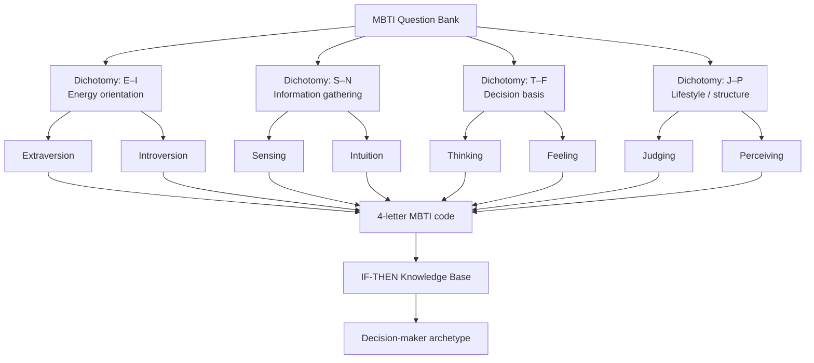

# Meridian — MBTI Executive Decision-Support System (DSS)

**Business domain:** Banking (Siam Bank Corp, fictional) — Retail Banking, Corporate Banking,
Customer Service, Finance & Accounting, IT, Human Resources, Engineering, Product, and
Executive/Risk functions.

**Purpose:** A mock-up prototype that helps an **HR Executive** use MBTI temperament results to
understand the decision-making personality and style of candidates being considered for
**upper-management roles**, and to manage follow-up communication with staff.

Stack: **Next.js 14 (App Router) + TypeScript + Tailwind CSS**, fully responsive, mock
localStorage-backed data layer (no external DB/API needed to run the prototype).

---

## 1. Application flows

**Flow 1 — Individual assessment (normal employees)**
```
Register → Login → MBTI Test → Result → Dashboard
```

**Flow 2 — HR / management oversight**
```
Login → Company MBTI Overview (all staff) → Send email follow-up
```

**Routing rule at Login** (also enforced at Register):
- Department = *Human Resources, Engineering Manager, Product Owner,
  Chief Technology Officer, Risk/Compliance Officer* → **Flow 2**
- Any other department → **Flow 1**

---

## 2. DSS architecture (Data / Model / Knowledge / Interface)

```
...
```

---

## 3. Structure chart

```
...
```

---

## 4. Use case diagram

```
...
```

---

## 5. ER diagram (database design)

The prototype stores this shape in `localStorage`; the same schema maps directly onto
relational tables for a production build.

```
...
```

---

## 6. Model: question classification tree

Each test item targets exactly one of four dichotomies; every dichotomy resolves to one
letter of the 4-letter MBTI code, which the knowledge base then maps to a decision-maker
archetype.



> The real question bank is intentionally **not included** in this prototype
> (per project scope) — see `lib/questions.ts`, which documents the exact shape
> to drop your own question set into.

---

## 7. Knowledge base: IF-THEN rules (excerpt)

The full table lives in `lib/mbti.ts` (`archetypeRules`). The four archetypes called out
in the assignment brief are the ones flagged `executiveFit: true`:

| Rule | Condition (MBTI code) | Conclusion (Archetype) | Executive fit |
|---|---|---|---|
| R1 | IF code = ENTJ | THEN archetype = **The Commander** — decisive strategic driver | ✅ |
| R2 | IF code = ESTJ | THEN archetype = **The Executive** — structured operational commander | ✅ |
| R3 | IF code = INTJ | THEN archetype = **The Architect** — long-horizon systems planner | ✅ |
| R4 | IF code = ISTJ | THEN archetype = **The Logistician** — methodical compliance-first executor | ✅ |
| R5 | IF code = ENTP | THEN archetype = The Debater | — |
| R6 | IF code = INTP | THEN archetype = The Logician | — |
| … | … (16 rules total, one per MBTI code) | … | — |

HR Executives can filter the company view to **executive-fit archetypes only** when
shortlisting candidates for upper-management roles.

---

## 8. UI / dashboard design notes

The interface uses a deep-navy / brass banking palette (`Fraunces` display serif +
`Inter` body sans) to read as a trustworthy internal executive tool rather than a
generic SaaS template. Screens included in this prototype (design these further in
Figma if a high-fidelity mock is required for submission):

- **Login** — username, password, department selector, routing hint
- **Register** — Flow 1 entry point
- **MBTI Test** — one question at a time, progress bar, dichotomy label
- **Result** — 4-letter type, dichotomy bar charts, archetype card
- **Dashboard** (employee) — personal type, breakdown, retake option
- **Company Overview** (HR/managers) — stats, filters, staff table, email log

---

## 9. Getting started

```bash
npm install
npm run dev
```

Then open http://localhost:3000.

**Demo accounts** (seeded automatically on first load):

| Username | Password | Department | Flow |
|---|---|---|---|
| aran.suksawat | password123 | Retail Banking | Flow 1 (has a result) |
| warut.phetchara | password123 | Retail Banking | Flow 1 (no result yet) |
| hr.suda | hrpass123 | Human Resources | Flow 2 |
| cto.peter | hrpass123 | Chief Technology Officer | Flow 2 |
| risk.malee | hrpass123 | Risk/Compliance Officer | Flow 2 |

All data is mock and stored in the browser's `localStorage` — no backend required.
